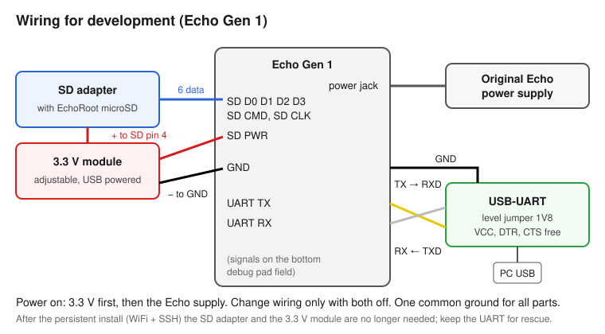
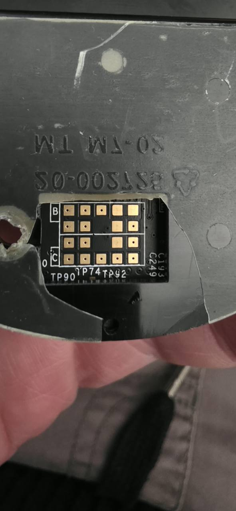
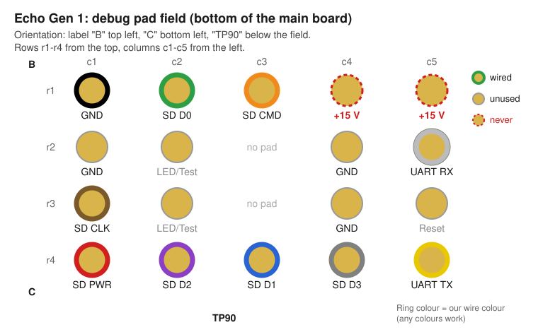
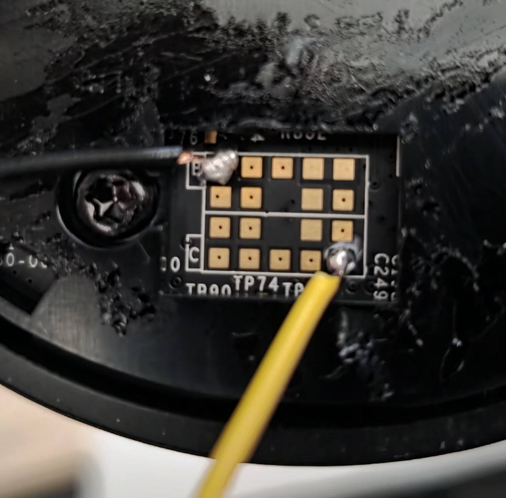
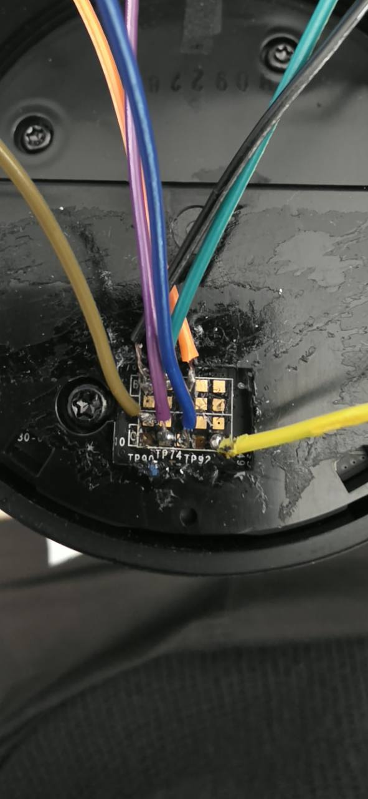
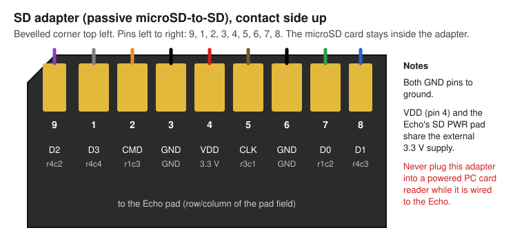
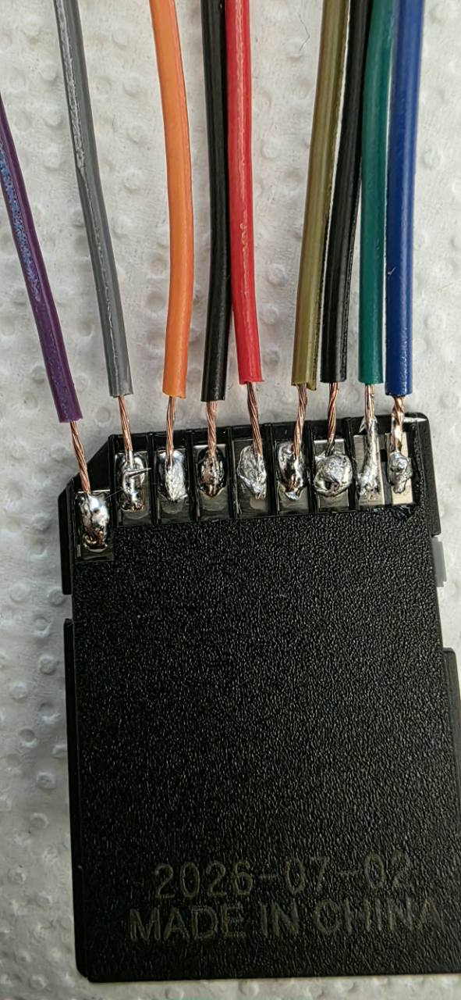
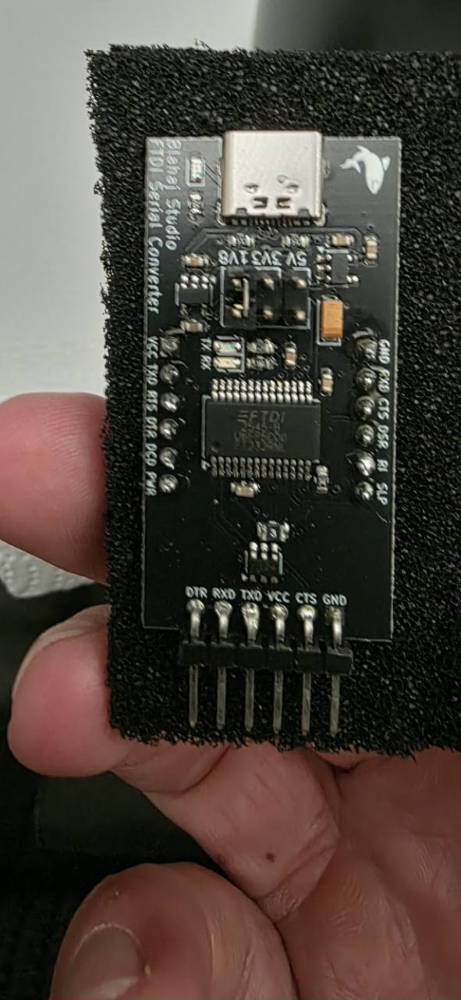

# Echo Gen 1: unlock it and run the assistant

This guide takes you from a stock Amazon Echo (first generation, the tall cylinder) to a
development device: your own Linux userspace, WiFi, SSH, and the voice assistant.

It is a condensed overview. The topic documents in [`docs/`](docs/) (see the list at the end) hold
the detail and record what was tested on real devices; the dated bring-up notes are kept in
[`docs/history/`](docs/history/).

## Credit: the hardware access and the base image are not ours

Everything below stands on other people's work. We did not find the debug pads, and we did not
build the open bootloader or the SD image.

- **EchoRoot** by André Zwing (GPL-2.0-or-later): <https://gitlab.com/AndreRH/echoroot>.
  Setup: <https://andrerh.gitlab.io/echoroot/SETUP.html>.
  Wiring (with the picture): <https://andrerh.gitlab.io/echoroot/CIRCUIT.html>.
  Release used here: [v0.8](https://gitlab.com/AndreRH/echoroot/-/releases/echoroot-v0.8).
- **u-boot-echo**, the open bootloader on that SD image: <https://gitlab.com/AndreRH/u-boot-echo>.
- **MWR Labs, 2017**, the original research: the debug pads expose a UART and an external SD
  card that is booted before the internal memory.
  <https://labs.reversec.com/advisories/2017/08/amazon-echo-rooting>.

Read the EchoRoot pages first. This guide only adds what we verified on top of them. Without
this foundation we would never have got a single line of our own code onto an Echo: thank you,
André, and everyone who shared their findings ([all credits](../../../../README.md#thank-you)).

## 1. What you get, what you need

**What you get**

- Your own `/sbin/init` on the internal flash, next to the original kernel and DSP firmware.
- WiFi (WPA2, DHCP) and key-only root SSH/SFTP after every boot, with no SD card and no extra
  supply. The Alexa services do not start on this path.
- The assistant (Go program in [`core/`](../../../../core/)) on top, using the original DSP audio chain.

**Shopping list**

| Part | What we used | Why / what to look for |
| --- | --- | --- |
| Amazon Echo, 1st generation (tall cylinder) | Two units | Only units with copyright 2016 or older work (EchoRoot). Later editions have the SD pads disabled. |
| The Echo's original power supply | The one that came with it | A weak or wrong supply caused confusing boot failures on our unit. |
| USB-UART adapter with **1.8 V** logic level | FTDI FT232-based USB-C adapter with a 5V / 3V3 / 1V8 jumper | The Echo's serial port runs at 1.8 V. Pins DTR, RXD, TXD, VCC, CTS, GND; only RXD, TXD and GND are used. |
| Passive microSD-to-SD adapter | The plain adapter that comes with microSD cards | Gets nine wires soldered to its contacts and stays wired to the Echo. Do not use a card reader. |
| microSD card, 4 GB or more | Any brand | Holds the EchoRoot image (2.1 GB unpacked). |
| Adjustable 3.3 V regulator module | USB-powered adjustable module with a voltage display | Powers the SD card only. Set to 3.3 V before connecting. |
| Thin insulated wire, about 10 colours | Stranded hook-up wire | One colour per signal makes checking easier. Thinner wire is easier on the small pads. |
| Dupont jumper wires and pin headers | Rainbow jumper set | To connect the harness to the UART adapter and the 3.3 V module without soldering them. |

**Tools:** soldering iron with a fine tip, thin solder, flux, tweezers, a magnifier or phone
camera zoom, a multimeter (DC voltage and continuity), hot glue or tape for strain relief.
The Echo does not have to be opened (section 2.1); for the inside see the
[iFixit teardown](https://www.ifixit.com/Teardown/Amazon+Echo+Teardown/33953).

After the persistent install (section 5) only the UART stays useful, as a rescue path; the SD
adapter and the 3.3 V module are no longer needed.

**Risk.** Soldering to the pads can destroy them. One of our two Echos lost two pads and was
abandoned. All our successful tests were done on the second unit. You can brick the device;
nothing here is covered by any warranty. Never connect the SD adapter to the Echo and to a
powered PC card reader at the same time.

## 2. Hardware: what is soldered where

EchoRoot's [wiring page](https://andrerh.gitlab.io/echoroot/CIRCUIT.html) is the original
reference. Below is the same wiring as we built and verified it (details:
[`docs/hardware.md`](docs/hardware.md)).



### 2.1 Find the pad field

The debug pads sit on the underside of the main board, under the Echo's bottom. Peel off the
rubber foot: it is only glued. Under it the bottom plate has an opening above the pad field
(photo below), so the pads can be reached without opening the Echo or taking the board out.
Keep the foot; it can be glued back over the wires later. Orient yourself by the printed labels: **B** top left, **C** bottom left, **TP90** below the
field.



### 2.2 Which pad is what



| Pad | Signal | Goes to | Our wire colour |
| --- | --- | --- | --- |
| r1c1 | GND | common ground: SD GND pins, UART GND, 3.3 V module minus | black |
| r1c2 | SD D0 | SD adapter pin 7 | green |
| r1c3 | SD CMD | SD adapter pin 2 | orange |
| r1c4, r1c5 | **+15 V** | **nothing, ever** | — |
| r2c5 | UART RX | USB-UART **TXD** | white |
| r3c1 | SD CLK | SD adapter pin 5 | brown/olive |
| r4c1 | SD PWR | external +3.3 V, together with SD adapter pin 4 | red |
| r4c2 | SD D2 | SD adapter pin 9 | violet |
| r4c3 | SD D1 | SD adapter pin 8 | blue |
| r4c4 | SD D3 | SD adapter pin 1 | grey |
| r4c5 | UART TX | USB-UART **RXD** | yellow |

Not used: the other GND pads (r2c1, r2c4, r3c4), the two LED/test pads (r2c2, r3c2) and Reset
(r3c5). Colours are only our convention; any colours work if you keep a table.

### 2.3 Solder

1. Everything unplugged. Tin each pad and each wire end first, then join them with a short touch
   of the iron. The pads are small and can lift off: one of our Echos lost two pads.
2. Start with GND (r1c1) and UART TX (r4c5): with those two you can already see the boot log.

   

3. Add the SD and power wires, then UART RX. Check each joint with the multimeter's continuity
   mode against its neighbours (no bridges) and along the wire.
4. Relieve the strain: fix the bundle to the housing with hot glue or tape so no wire pulls on a
   pad.

   

### 2.4 The SD adapter

Solder nine wires to the contacts of a passive microSD-to-SD adapter; the microSD card with the
EchoRoot image stays inside it.





Both GND pins (3 and 6) go to ground. VDD (pin 4) and the Echo's SD PWR pad share the external
3.3 V. Never put this adapter into a powered PC card reader while it is wired to the Echo.

### 2.5 USB-UART and power

- **Level jumper on 1V8.** Not 3V3 or 5V: the Echo's serial port runs at 1.8 V.
- **Cross the lines:** Echo UART TX → adapter RXD, Echo UART RX → adapter TXD, GND → GND.
  Leave VCC, DTR and CTS free: the adapter does not power the Echo.
- Remove any packing foam from under the adapter's pins: it can conduct.



- **3.3 V module.** Set it to 3.3 V while it is disconnected, then measure again at the SD
  adapter (pin 4 against GND) once everything is connected. A mis-set regulator (0.6 to 1.4 V)
  cost us hours early on.
- **Switch-on order:** 3.3 V first, then the Echo supply. For a full cold start switch both off
  for a few seconds, then on in that order. Change wiring only with both supplies off.

### Serial console

Settings: 115200 baud, 8N1, no flow control. Only one program may hold the port. The helper
scripts are Windows PowerShell (`System.IO.Ports.SerialPort`, no extra driver packages beyond
the adapter's own):

- [`tools/Read-EchoConsole.ps1`](tools/Read-EchoConsole.ps1) reads the port into a log and a
  status file under `devices/echo/local/runtime/`.
- [`tools/Send-EchoCommand.ps1`](tools/Send-EchoCommand.ps1) sends one line to the reader, or
  repeats Enter (`-InterruptBoot`) to stop the bootloader countdown.

Details and expected prompts: [`docs/boot-and-root.md`](docs/boot-and-root.md). On Linux or macOS use
any terminal program; these scripts were not tested there.

## 3. First boot from SD and root access

This path is **tested** on our second Echo and is now only the manual rescue path.

1. **Write the EchoRoot v0.8 image to a microSD card** and put the card in the SD adapter. The
   image is not in this repository; download it from the release page. Check the file against
   the hashes in [`docs/boot-and-root.md`](docs/boot-and-root.md). Overwrite only
   a card you are sure about: the Windows disk numbers in our old notes are history.
2. **Open the console, then power on** (3.3 V first, then the Echo supply) and press Enter
   repeatedly during the countdown. You should land at `uboot >` with
   `U-Boot 2010.06-00011-ge1ab9145d5`. Check with `version`. The Echo's own internal U-Boot
   is locked and does not give you this prompt.
3. **Find the root partition on the internal flash** (U-Boot device 1). The eMMC has eight GPT
   partitions; the two root slots are `main-A` (6) and `main-B` (7). On our first Echo main-B
   was clean; on the second, main-A was. Look at both and read the ext superblock
   (`mmc read`, `md.b`, into RAM only). Take the slot that has `/boot/uImage` and a clean
   superblock (state valid, no RECOVER flag). Do not guess, and do not run `fsck`.
4. **Load the internal kernel and start a shell as PID 1:**
   `ext4load mmc 1:<slot> 82000000 /boot/uImage`, then set `bootargs` with
   `root=PARTUUID=<slot-partuuid> ro rootfstype=ext2 rootwait mem=200M@0x80000000 ... init=/bin/sh`
   and `bootm 82000000`. The full line is in [`docs/boot-and-root.md`](docs/boot-and-root.md). Keep
   `mem=200M@0x80000000`. Do **not** `saveenv`, and do not run `run mmcargs`.
5. **Confirm root.** You get `sh-3.2#`; `id` shows `uid=0`, `uname` shows
   `Linux 2.6.37 armv7l`.

Caveats the notes record:

- **Why ext2 and not ext3:** the root is ext3, but `ext3` with `noload` fails on this kernel.
  A clean superblock lets you mount it read-only as ext2. This is only safe when the
  superblock check passes.
- **Watchdog:** a shell started as PID 1 does not feed the hardware watchdog, and the unit
  resets after about 60 seconds (we saw 56 s). Feed `/dev/watchdog` right away. See
  [`docs/boot-and-root.md`](docs/boot-and-root.md) for the loop that kept one session
  alive for over 800 seconds. Never `exit` from PID 1.
- **The SD card is read in U-Boot only.** Linux fails to initialise the SD host (`-110`). In
  U-Boot, SD access at the default clock fails; the notes record a RAM-only workaround
  (1-bit bus, 4 MHz) that is exact to one U-Boot build. It is optional: the steps above read
  the internal flash, not the SD card.
- **U-Boot addresses, partition numbers and sector counts differ between units.** The two
  Echos we have differed in active slot and eMMC size. Verify, do not copy.

## 4. Backup before you write anything

Be honest about what exists: a full backup of the internal eMMC was **never made**. Over UART
(about 11.5 kB/s) a raw 3.9 GB dump would take roughly 94 hours, and no tested binary
transfer path existed then. We chose a targeted backup instead, taken once SSH worked:

- the small partitions 1 to 4 (xloader, recovery, boot, idme), each compared against its
  source SHA-256;
- the beginning and end of the GPT;
- the original `init`, boot/start configuration, and kernel modules/firmware as an archive.

Keep these backups private (they hold device identity). The method and partition table are in
[`docs/recovery.md`](docs/recovery.md). The untested `dd` recipes are
left out on purpose: a swapped source and target overwrites the original system.

## 5. Persistent development access

Goal: after the SD card and the 3.3 V supply are gone, the Echo boots by itself into WiFi and SSH.

**What gets installed** (on the internal root, in `/usr/local/echo-dev`; bootloader, kernel,
GPT and IDME are untouched):

- [`src/echo-init.sh`](src/echo-init.sh) as `/sbin/init`: feeds the watchdog, mounts a RAM
  `/mnt`, makes the root read-only, gives a serial rescue shell, starts the service loop.
- [`src/echo-service-loop.sh`](src/echo-service-loop.sh): loads the WiFi modules, runs
  `wpa_supplicant`, `udhcpc` ([`config/udhcpc-echo.script`](config/udhcpc-echo.script)) and
  `sshd` ([`config/sshd-persistent.conf`](config/sshd-persistent.conf)), restarting them in a loop.
- [`src/echo-reboot.sh`](src/echo-reboot.sh): the controlled restart. Use it; stock init
  signalling does not fit our small PID 1.
- `sshd` is OpenSSH 7.5p1 taken from the EchoRoot image. It is an old bootstrap server, not
  a hardened current one. Key-only root login; password login is off.

**How it is done (tested on two Echos):**

1. Boot to the root shell as in section 3. Feed the watchdog.
2. Upload the files over UART with [`tools/echo_console.py`](tools/echo_console.py)
   `--upload` (gzip plus base64, SHA-256 checked on the target, secrets never printed). The
   console is not binary safe, so never push raw binaries through the plain reader.
3. Try it in RAM first with [`tools/bootstrap-ram-access.sh`](tools/bootstrap-ram-access.sh):
   WiFi, DHCP and SSH come up from `tmpfs` with the same service loop. Log in over SSH.
4. Take the targeted backup (section 4) over SSH.
5. Run [`tools/install-persistent-access.sh`](tools/install-persistent-access.sh) on the Echo,
   **over UART**. It takes five arguments (root device number, eMMC block name, eMMC sector count,
   boot mode `main-A` or `main-B`, SHA-256 of the original `/sbin/init`) and checks each against
   the running system before it writes. It remounts the root read-write briefly, writes the files,
   switches `/sbin/init` atomically, and goes back to read-only.
6. Switch both supplies off, remove the SD card and the 3.3 V wire, power on with the Echo
   supply only.

Result on both units: SSH is back about 36 to 50 seconds after power-on, with the same host
key, and after a software restart about 36 to 43 seconds. After WiFi was taken down for three
seconds it recovered on its own in about 14 seconds. Ten cold starts, a real router outage and
a long network plus audio load test were **not** run.

**Secrets and per-device files stay out of git.** Everything private is in the git-ignored
`devices/echo/local/`: the WiFi configuration, the SSH host key, your developer key,
`authorized_keys`, the SSH profile `local/ssh/config` (alias `echo-dev` in our examples) and
the backups. On the Echo they live in `/usr/local/echo-dev/private/` (directory 0700, files
0600). Never disable SSH host-key checking; pin the host key once. On Windows, create the SSH key
under your normal user, not under a sandbox account. OpenSSH `StrictModes` needs `/usr/local`
to be mode 0755; the installer sets this.

**Daily use.** Wait about 40 seconds after power-on, then
`ssh -F devices/echo/local/ssh/config echo-dev` or, on Windows,
`tools/Invoke-Echo.ps1 -Command 'id'`. The root is read-only; for a change use
`mount -o remount,rw /`, edit, `sync`, `mount -o remount,ro /`. RAM logs are in
`/mnt/echo-net/` (`services.log`, `wpa.log`, `dhcp.log`, `sshd.log`). Details:
[`docs/network.md`](docs/network.md) and [`docs/boot-and-root.md`](docs/boot-and-root.md).

## 6. Deploying the assistant

The assistant is a static Go program built for ARMv7 (`CGO_ENABLED=0 GOARCH=arm GOARM=7`); it does not
depend on the old C library. What the device needs: the persistent access from section 5 (the
installer refuses to run without `/usr/local/echo-dev/private`), and a data partition that
`echo-mount-data.sh` mounts at `/mnt/data` for the assistant's state. Memory is tight (about 190 MB, no
swap); the service loop and the assistant have a memory guard so that SSH always stays alive.

On the PC (Git Bash; Go and Python 3 installed):

```sh
sh devices/echo/tools/deploy.sh            # vet, test, build, copy, install, restart
sh devices/echo/tools/deploy.sh --secrets  # also regenerate and copy the private secrets
ECHO_HOST=<ssh-alias> sh devices/echo/tools/deploy.sh   # another Echo
sh devices/echo/tools/deploy.sh --all      # every Echo with a settings file
```

The script uses `devices/echo/local/ssh/config` and Windows' OpenSSH when the host is listed
there, otherwise plain `ssh`/`scp`. It runs `go vet` and `go test`, builds the binary, copies it
with the scripts to a stage directory in RAM, then runs `install-assistant.sh` on the Echo. That
script writes only below `/usr/local/echo-dev`; init, bootloader and partitions stay as they are.
The service loop restarts the assistant within seconds. Secrets come from the git-ignored
`local/secrets.h` (copy `secrets.h.example`; one file for both device types)
and are generated into `private/jarvis-secrets.json` (mode 0600).

**Per-device settings.** If `devices/echo/local/devices/<host>.json` exists, it is installed as
that device's `device.json` (role, wake word, room, Spotify name and so on). Without it the
device keeps the file it has. See [`../../docs/18-several-echos.md`](../../docs/18-several-echos.md)
for the roles of several Echos. Use `--all` for a household with more than one Echo, so no
device is left running old code.

Control and checks on the device: `/usr/local/echo-dev/jarvis/jarvis ctl status`, `ctl tools`,
`ctl tool <name> <json>`. After a deploy of the service loop itself, restart with
`/usr/local/echo-dev/bin/echo-reboot`. Full description of the assistant:
[`../../docs/16-assistant.md`](../../docs/16-assistant.md). Hardware test of speaker, microphones,
LED ring and buttons: [`docs/known-issues.md`](docs/known-issues.md) and [`docs/audio.md`](docs/audio.md).

## 7. Known issues and recovery

- **UART stays the recovery path.** Keep the wires or at least the pads accessible, and keep
  the EchoRoot SD card. Our own init gives a root shell on the serial port. Do not leave the
  SD card inserted in normal use: with it in, the unit starts the SD kernel and ends in a root
  mount panic.
- **Never run the historical EchoRoot installer blindly** (`/home/root/install.sh`). It copies
  U-Boot to the internal flash, overwrites main-A, and assumes SD is `mmcblk0` and the eMMC is
  `mmcblk1`. That mapping is not true in every session. Check the real devices before any write.
- **Do not trust block names.** The SD and the eMMC swap names between sessions.
- **Restart with `echo-reboot`,** not with stock `reboot`/init signals. It syncs and remounts
  read-only first.
- **No time source.** There is no usable RTC and no NTP set up in the base install; the clock
  starts wrong. The assistant does its own SNTP.
- **Direct ALSA playback caused a kernel oops.** Use the DSP/PulseAudio chain
  ([`src/echo-audio.sh`](src/echo-audio.sh)) only.
- **SSH timeouts after idle:** once a TCP timeout appeared that went away after turning WiFi
  power save off and a few pings. The cause is not isolated.
- **No power or no serial output:** check both supplies, ground, and the order. See
  [`docs/known-issues.md`](docs/known-issues.md).
- **Do not re-solder first.** If boots fail, measure the 3.3 V at the SD adapter under load
  before you touch the pads again.
- **The Echo Dot is different hardware.** The Dot 2 has its own guide:
  [`../dot2/README.md`](../dot2/README.md). Nothing here
  (pads, U-Boot addresses) applies to it.

Not yet done or not tested: ten cold starts, a router outage, a long mixed network and audio
run, a replacement for the old bootstrap OpenSSH, and a full eMMC backup.

## 8. Detailed documents

All files are in [`docs/`](docs/). The dated bring-up notes (with dead ends and raw measurements)
are kept in [`docs/history/`](docs/history/).

| Document | Content |
| --- | --- |
| [hardware.md](docs/hardware.md) | Board, components, pad field, wiring plan, SD adapter pin order, UART adapter, power and measuring |
| [boot-and-root.md](docs/boot-and-root.md) | Serial console, rescue boot into a root shell, persistent install, storage layout, development environment, EchoRoot image and sources |
| [recovery.md](docs/recovery.md) | Partition table, targeted backup, why no full backup exists, rescue paths, SD writer warnings |
| [network.md](docs/network.md) | WiFi, SSH, daily use, acceptance results, limits, why no coding agent runs on the Echo |
| [audio.md](docs/audio.md) | Audio chain, microphones, echo cancellation, volume control, RAM-only audio test runbook |
| [known-issues.md](docs/known-issues.md) | Watchdog reset, SD problems, ext3 `noload`, supply faults, installer traps, dark LED diagnosis, LED/button/GPIO test results |

More: [`../../README.md`](../../README.md) (all Echo models),
[`CLAUDE.md`](../../../../CLAUDE.md) (working rules, *Working on the Echo hardware*), [`tools/README.md`](tools/README.md) (the
console, network and installation tools).
