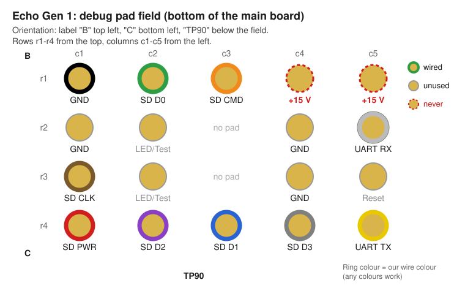
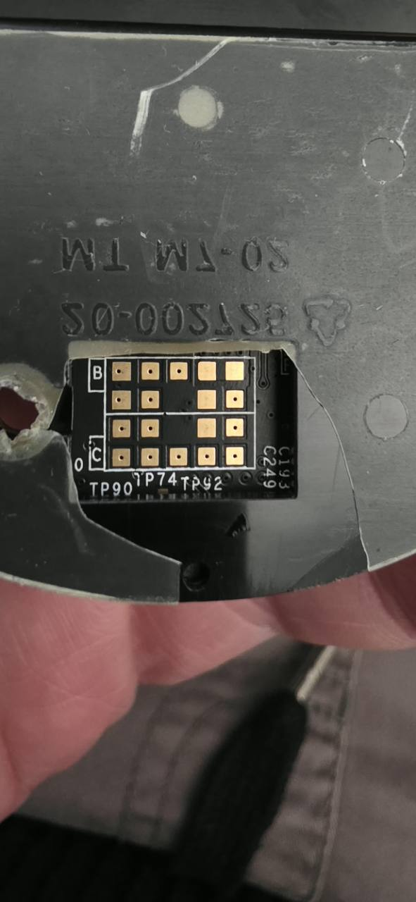
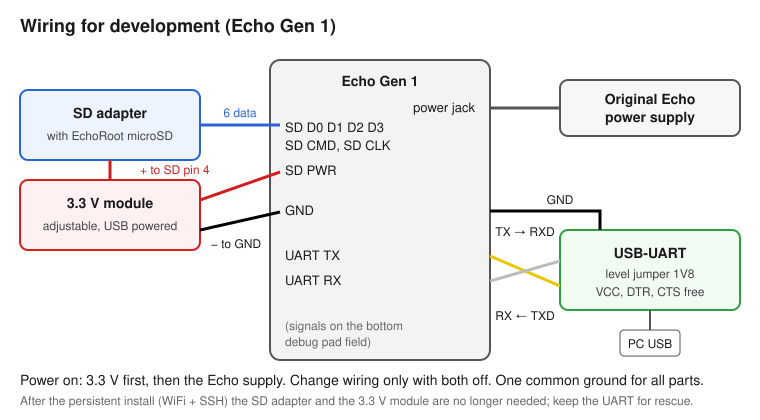
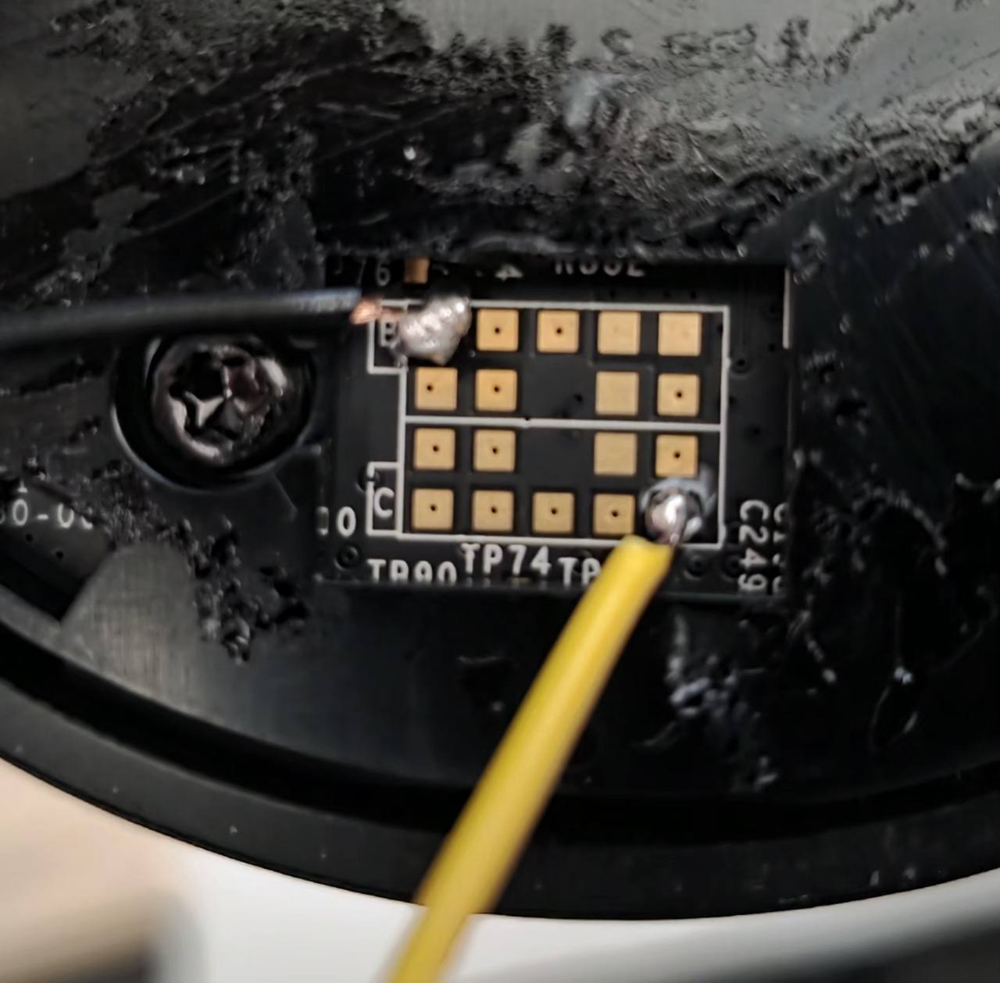
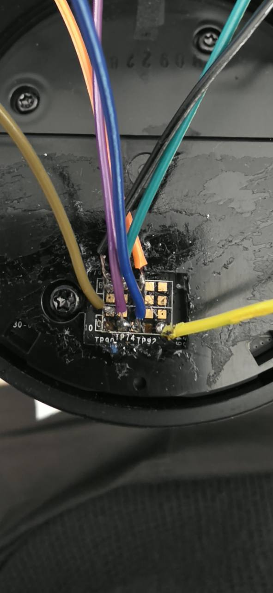
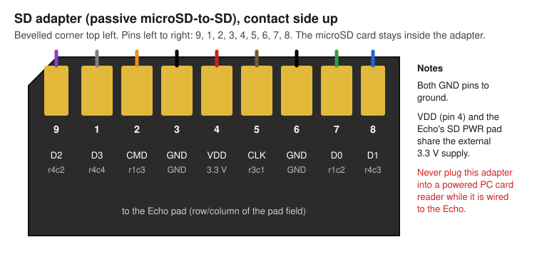
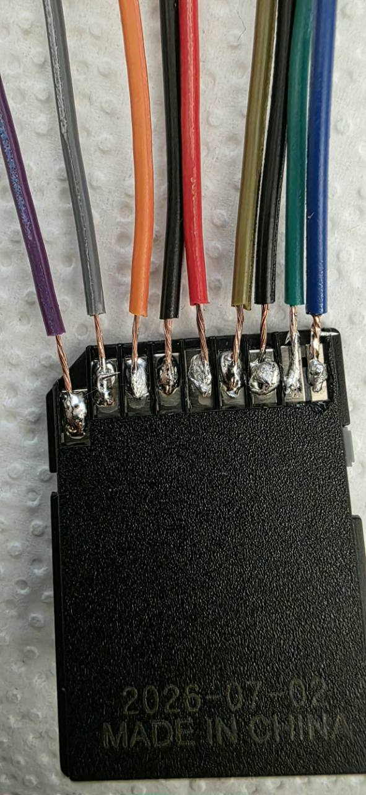
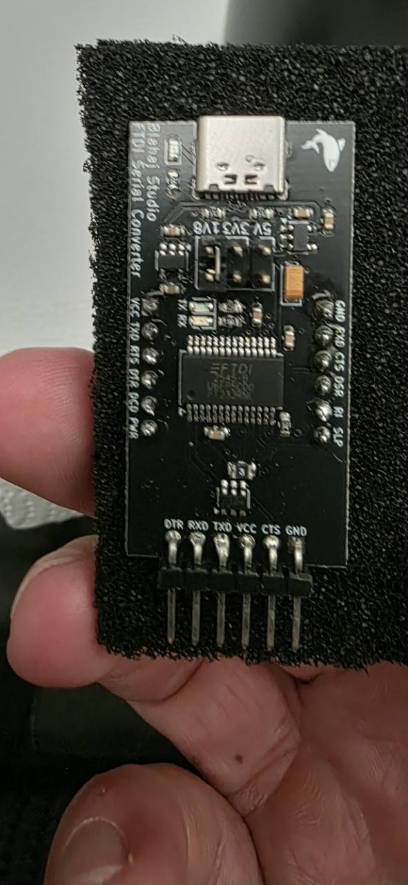

# Hardware, power and wiring

Tall Amazon Echo Gen 1. Dated bring-up notes: [history/01-hardware.md](history/01-hardware.md).

## Device

Board from the photos: PCB `30-000791 REV 06`, PCBA `31-000832`. Original board roughly **85 x 56 mm**, tallest component roughly **19 mm** (measured on the previous board, not a full survey of the free installation space).

| Component | Identification |
| --- | --- |
| SoC | TI DM3725CUS100 (readable on photos); ARM Cortex-A8, 1 GHz, NEON, VFPv3; userland softfp EABI (`/lib/ld-linux.so.3`), EGLIBC 2.19 |
| RAM | Bootloader reports 256 MiB; Linux gets 200 MiB (`mem=200M@0x80000000`), `MemTotal` 194556 kB |
| Internal flash | SanDisk or Samsung eMMC (differs between units); Linux reports 3.64 GiB, eight GPT partitions ([recovery](recovery.md)) |
| WiFi/Bluetooth | Qualcomm/Atheros chip on the main board (AR6004, `ath6kl_sdio`); firmware and driver required. Bluetooth and WiFi share one chip |
| Speaker codec | `tlv320aic32xx` on I2C 3-0018; ALSA card `OMAP3EVM`, but playback only through DSP/PulseAudio ([audio](audio.md)) |
| Microphone ADCs | 4 x `tlv320adc31xx` (A-D) on I2C 2-0018...001b; together 8 channels, processed by the DSP |
| LED drivers | 4 x `lp5523` on I2C 2-0032...0035; 36 channels = 12 RGB LEDs, plus `power-led` and `network-led` |
| Buttons | `gpio-keys` -> `/dev/input/event0` (action button, mute latch) |
| Volume ring | `rotary-encoder` -> `/dev/input/event1` |
| PMIC | `tps65910` on I2C 1-002d (not changed) |

LED, button and audio behaviour: [known-issues.md](known-issues.md) (hardware test results) and [audio.md](audio.md).

Two Echo Gen 1 units have been used. The first lost two pads while soldering; **all successful software tests refer to the second unit**. A further unit (different chip, different eMMC) was set up later in one session, see [network.md](network.md). Old photos and the early stock boot log must not be treated as the current device state without checking.

The Echo Dot is different hardware (the Dot 2 is MT8163-based): nothing on this page (pads, U-Boot addresses) applies to it; see [`../../dot2/`](../../dot2/).

## Debug pad field

The debug pads sit on the underside of the main board. View onto the pads so that **B is top left**, **C bottom left** and **TP90 below**. Rows count from the top, columns from the left. If a photo is rotated, orient yourself by the labels first.

| Position | c1 | c2 | c3 | c4 | c5 |
| --- | --- | --- | --- | --- | --- |
| r1 | GND | SD D0 | SD CMD | +15 V | +15 V |
| r2 | GND | LED/Test | no pad | GND | UART RX |
| r3 | SD CLK | LED/Test | no pad | GND | Reset |
| r4 | SD PWR | SD D2 | SD D1 | SD D3 | UART TX |

Pinout reference: [Vanderpot pad image](https://vanderpot.com/wp-content/uploads/2016/06/pinout.png). **Connect nothing from the UART/SD wiring to the 15 V pads.** The LED/test pads, Reset and the other GND pads (r2c1, r2c4, r3c4) are not used in this setup.

## Wiring plan

| Wire colour | Pad | Other end |
| --- | --- | --- |
| Black | r1c1 GND | Common ground: SD GND pins, UART GND and 3.3 V module minus |
| Green | r1c2 SD D0 | Full-size SD pin 7 |
| Orange | r1c3 SD CMD | SD pin 2 |
| White | r2c5 UART RX | USB-UART TXD |
| Brown/olive | r3c1 SD CLK | SD pin 5 |
| Red | r4c1 SD PWR | External +3.3 V; together with SD VDD pin 4 |
| Violet | r4c2 SD D2 | SD pin 9 |
| Blue | r4c3 SD D1 | SD pin 8 |
| Grey | r4c4 SD D3 | SD pin 1 |
| Yellow | r4c5 UART TX | USB-UART RXD |

Colours are a project convention, not an electrical guarantee. Continuity was checked by the user; photos alone prove neither sound solder joints nor absence of shorts. Relieve the wires mechanically (hot glue or tape). After any re-soldering check continuity and unwanted connections with the power off. Do not demand re-soldering as a first reaction to boot problems: pads were damaged that way on the first device (see [known-issues.md](known-issues.md)).

### Full-size SD adapter

A passive microSD-to-SD adapter is soldered (the memory chip is not wired directly); the microSD card with the EchoRoot image stays inside it. View the contact side, contacts up, bevelled corner top left: **left to right 9, 1, 2, 3, 4, 5, 6, 7, 8**.

| SD pin | Signal | Colour |
| --- | --- | --- |
| 9 | D2 | Violet |
| 1 | D3 | Grey |
| 2 | CMD | Orange |
| 3 | GND | Black |
| 4 | VDD 3.3 V | Red |
| 5 | CLK | Brown/olive |
| 6 | GND | Black |
| 7 | D0 | Green |
| 8 | D1 | Blue |

Both black SD wires go to ground. SD pin 4 and the Echo's SD PWR pad share the external supply. The Echo is **not** powered from the UART adapter. Never connect the SD adapter to the Echo and to a powered PC card reader at the same time.

### USB-UART

Used: FTDI/FT232RNL-compatible BLAHAJ USB-C adapter. USB-C on top, six-pin header at the bottom, board labelling readable: **DTR, RXD, TXD, VCC, CTS, GND** from left to right (the labelling on the actual adapter is authoritative).

- Level jumper on **1V8**; not 3V3/5V (the Echo's serial port runs at 1.8 V). RX/TX are crossed as in the table above.
- VCC, DTR and CTS stay free; no hardware handshake.
- 115200 baud, 8 data bits, no parity, 1 stop bit (historical Windows port COM6).
- Remove packing foam under the pins; it can be conductive.

### Power and measuring

Original Echo power supply plus a separate USB-powered adjustable 3.3 V module (model/order references are in the local device profile). The current reserve under load has not been measured; the regulator is not a proven current-limited bench supply. For normal operation after the persistent install ([boot-and-root.md](boot-and-root.md)) only the matching original power supply is needed.

1. Change wiring only with the power off; Echo supply and 3.3 V module off.
2. Check 3.3 V at the module output, then directly at the SD adapter under load (pin 4 against GND). Protect the regulator against being turned.
3. To start, **3.3 V first**, then switch on the original Echo supply. The UART can be plugged into the PC beforehand.
4. For a full cold start switch both supplies off, wait a few seconds, then switch them on again in this order.

Multimeter used (AstroAI AM33D): black in **COM**, red on the right in **VΩmA**, rotary switch **20 V DC (V=)** top left. Black to GND, red to SD VDD. Do not use the current, resistance or continuity ranges while the circuit is powered. Do not bridge neighbouring pads with the probe tip.

Early on 0.6-1.4 V/OL was reported; the mis-set regulator was then corrected and 3.3 V confirmed. That does not rule out short dips or signal problems, and a multimeter is no substitute for an oscilloscope here.

### Soldering notes (from the setup guide)

Tin each pad and each wire end first, then join them with a short touch of the iron. Start with GND (r1c1) and UART TX (r4c5): with those two the boot log is already visible. Then add the SD and power wires, then UART RX. Check each joint with the multimeter's continuity mode against its neighbours (no bridges) and along the wire.
